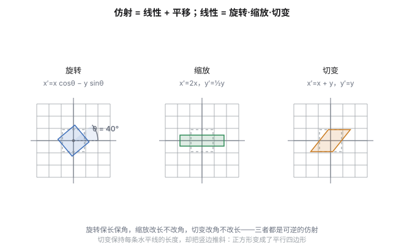
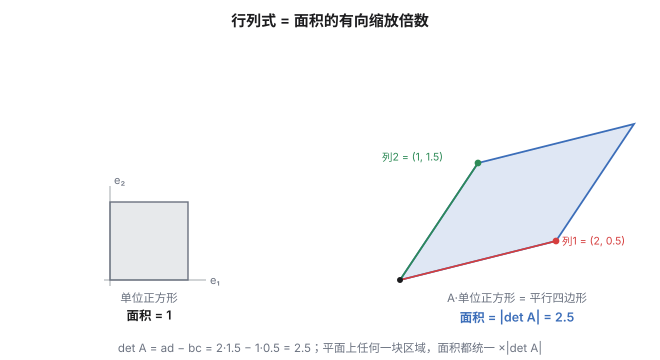
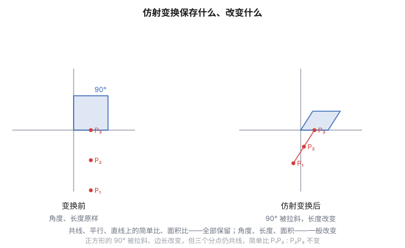
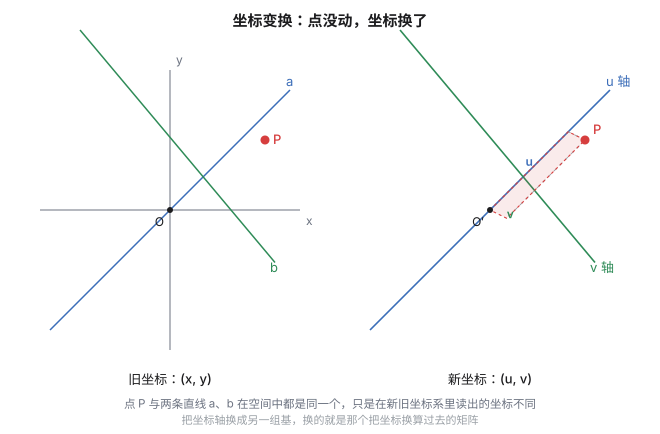
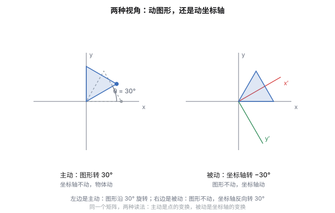
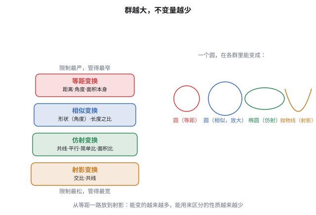
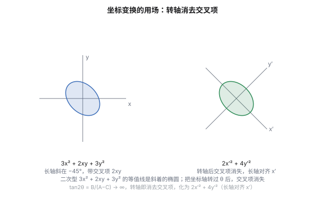

这个博客里，"变换"这个词出现过很多次，可每一次都是**悄悄用的**。

- 讲[椭圆](post.html?slug=ellipse-advanced)时，我们把圆纵向压扁 $b/a$ 倍变出椭圆，说"这是一次仿射变换"，用它一行算完原来要半页的题；
- 讲[圆锥曲线](post.html?slug=conic-general)时，我们"先平移、再旋转"，把 $Ax^2+Bxy+Cy^2+Dx+Ey+F=0$ 的交叉项消掉，说这是主轴定理；
- 讲[分形](post.html?slug=fractals)时，我们说一张图"缩小一半再复制几份拼回去"还是它自己，那是迭代函数系统——里面每一个函数，都是仿射变换。

三次出场，三种打扮，可骨架是同一副。这篇文章想做一件事：**把这门被反复借用、却从没被单独讲过的语言，系统地立起来。**

立起来之后，你会得到一个贯穿始终的问题意识——

> **同一个几何操作，是"把点动一动"，还是"把坐标系换一换"？**

这是理解变换的枢纽。仿射变换站在前一种立场（点动、系不动），坐标变换站在后一种立场（点不动、系动），而它们描述的是**同一件事**。一旦看清这层对偶，圆锥曲线为什么能靠平移旋转化简、椭圆为什么能压回圆、分形为什么自相似，就从三个孤立技巧变成一句话的三个例子。

## 读这篇之前，你只需要这些

这篇文章会用一点点线性代数——矩阵、行列式、基。**你不需要先去修一门课**：每一个概念都在用到的当口就地讲清，用到才讲、不讲不用。

真正的前提全是高中学过的：

- 平面向量与坐标运算（一个点 $(x,y)$、一次函数 $y=kx+b$、两点距离）；
- 一元二次方程与配方法（把 $x^2+bx$ 配成平方）；
- 平面几何的平行、中点、相似、共线。

至于超出高中的那几个概念，先看这张地图，读到不认识的记号先往下走：

| 概念 | 用在哪节 | 一句话是什么 |
|---|---|---|
| 矩阵与矩阵乘法 | 全文 | 把一组数排成方阵，按"行乘列"相乘，用来打包一堆线性运算 |
| 列向量 | 一、二 | 把点 $(x,y)$ 竖着写成一列 $\binom xy$ |
| 行列式 | 一、三 | 从一个方阵算出的一个数；二维时是面积的有向缩放倍数 |
| 基与坐标 | 二 | 选定两个"标尺方向"，任何点都能用它们量出唯一一组数 |
| 可逆矩阵 | 一、二 | 能"撤销"的变换；对应它不把图形压成一条线或一个点 |

路线图（免得中途迷路）：

- **第一节**：仿射变换——固定坐标系，去**动点**。它会保住什么、破坏什么；
- **第二节**：坐标变换——固定图形，去**换系**。基变了，点的坐标跟着变；
- **第三节**：把两者接上——同一个矩阵，两种读法，这是全文的枢纽；
- **第四节**：什么是"不变量"，为什么它是几何里最值钱的东西；
- **第五节**：应用串讲，把椭圆、圆锥曲线、分形那几招接回这个框架；
- **番外**：物理里的坐标变换——从伽利略到爱因斯坦，同一股劲的另一副面孔。

## 一、仿射变换：固定坐标系，去动点

先说最常见的想法：坐标系钉死不动，我们**搬动、拉伸、压扁图形上的每一个点**。

一个仿射变换长这样：

$$T(\mathbf x)=A\,\mathbf x+\mathbf b,\qquad \mathbf x=\binom xy$$

拆成两块看，各司其职：

- $A$ 是一个 $2\times2$ 矩阵，负责**线性部分**——旋转、缩放、拉伸、剪切，所有"过原点"的形变；
- $\mathbf b$ 是一个常向量，负责**平移**——把整个图形平行搬动一段。

两类拼起来，就是仿射变换的全部。它有三个你一看就懂的基本动作，作为我们心里的"积木"：

$$平移:\ \binom xy\mapsto\binom{x+t_x}\\{y+t_y},\qquad 缩放:\ \binom xy\mapsto\binom{sx}\\{sy},\qquad 剪切:\ \binom xy\mapsto{x+ky}\\{y}$$

旋转、缩放、剪切这几种线性动作，配合平移，就能拼出任意仿射变换——它们都是可逆的，把图形变形却不会压塌。

"仿射"（affine）这个词的本义，就是**保持共线与平行**。一条直线，无论怎么平移、旋转、均匀拉伸、剪切，变过来还是一条直线；两条平行线，变过来还是两条平行线。它**不保证**长度不变、角度不变——这正是它能"把椭圆压成圆"的原因：形状可以变，但"直"和"平行"这些骨架不许动。

> [!note] 为什么直线还是直线？
> 仿射变换的线性部分满足 $A(\mathbf u+\mathbf v)=A\mathbf u+A\mathbf v$、$A(c\mathbf u)=c\,A\mathbf u$。直线上两点 $\mathbf p,\mathbf q$ 连线上的点 $\mathbf p+t(\mathbf q-\mathbf p)$，被 $A$ 作用后变成 $A\mathbf p+t(A\mathbf q-A\mathbf p)$，仍是"起点 + 倍数的方向向量"，所以还在一条直线上。平移 $\mathbf b$ 只是给每个点加同一个向量，当然不破坏这条结论。

### 一个关键量：简单比不变

仿射变换会破坏长度和角度，但它**死死守住一个比例**——**简单比**（ratio）。

取一条直线上的三个点 $A,B,C$，定义

$$\lambda=\frac{\overline{AC}}{\overline{CB}}$$

（$\overline{AC}$ 表示有向线段 $AC$ 的长度，向右为正、向左为负）。仿射变换不改变这个 $\lambda$。换句话说，**共线三点之间的比例关系是仿射不变量**。

这不是巧合，而是"线性"的直接推论。设直线上 $\mathbf c=(1-\lambda)\mathbf a+\lambda\,\mathbf b$（即 $\mathbf c$ 分 $\overline{AB}$ 成 $\lambda:(1-\lambda)$），代入变换：

$$T(\mathbf c)=A\mathbf c+\mathbf b_0=\big((1-\lambda)A\mathbf a+\lambda A\mathbf b\big)+\mathbf b_0=(1-\lambda)T(\mathbf a)+\lambda\,T(\mathbf b)$$

变换后 $\mathbf c$ 的像，仍然分 $T(\mathbf a),T(\mathbf b)$ 的连线成**同一个** $\lambda$。中点（$\lambda=\tfrac12$）也因此被保住——这也解释了[椭圆篇](post.html?slug=ellipse-advanced)里"压缩保中点、保共轭直径"为什么成立：它们都只用了线性结构。

### 面积的命运：行列式

长度会乱、角度会乱，但**面积的缩放是统一的**——整个平面上任何一块区域，面积都按同一个倍数变。这个倍数，就是矩阵 $A$ 的**行列式** $\det A$。

二维情形下，若 $A=\begin{pmatrix}a&b\\c&d\end{pmatrix}$，则

$$\det A=ad-bc,\qquad \text{面积缩放倍数}=|\det A|$$

- $\det A=2$：面积翻倍；$\det A=\tfrac12$：面积缩到一半；
- $\det A=1$：面积不变（旋转、剪切都是这类）；
- $\det A=0$：图形被压成一条线甚至一个点——这时 $A$ 不可逆，我们后面总默认 $\det A\ne0$。

椭圆篇里那句"面积按 $b/a$ 缩放"，说的就是压缩矩阵 $\begin{pmatrix}1&0\\0&b/a\end{pmatrix}$ 的行列式恰为 $b/a$。行列式在这里第一次露脸，记住它：**行列式 = 面积的有向缩放倍数**，第三节我们靠它打通"动点"和"换系"。

为什么"缩放倍数"就等于"平行四边形的面积"？因为 $A$ 把标准基向量 $\mathbf e_1,\mathbf e_2$ 搬到它的两列 $A\mathbf e_1,A\mathbf e_2$，单位正方形正好被映成以这两列为边的平行四边形，而这个平行四边形的（有向）面积，按定义就是 $\det A$。仿射变换把任意区域统一按这个倍数缩放，所以一个行列式管住了整张平面。

## 二、坐标变换：固定图形，去换系

现在换一套完全相反的立场。

图形钉在原地**一动不动**，我们**换一把尺子**去量它——移动坐标原点、旋转坐标轴，或者干脆换两个新的"标尺方向"（**基**）。点的客观位置没变，但描述它的那组数变了。这就是坐标变换。

先建立"基"这个概念。一组基就是两个不共线的向量 $\mathbf e_1,\mathbf e_2$，平面上任何点都能唯一地表示成

$$\mathbf x=x'\,\mathbf e_1+y'\,\mathbf e_2$$

这一对数 $(x',y')$ 就是点在新基下的**坐标**。我们平时用的直角坐标，取的是 $\mathbf e_1=(1,0),\mathbf e_2=(0,1)$ 这两个特殊基，叫**标准基**，所以平时感觉不到"基"的存在——但它一直在。

### 换基 = 换一把尺子

设旧基是标准基，新基是两个向量 $\mathbf u,\mathbf v$。把它们的坐标并排写成一列矩阵，叫**过渡矩阵** $P$：

$$P=\begin{pmatrix}\vert&\vert\\\mathbf u&\mathbf v\\\vert&\vert\end{pmatrix}$$

它的两列分别是新基在旧坐标下的坐标。那么同一个点，旧坐标 $\mathbf x$ 与新坐标 $\mathbf x'$ 的关系是

$$\mathbf x=P\,\mathbf x'\qquad\Longleftrightarrow\qquad \mathbf x'=P^{-1}\mathbf x$$

一个具体例子最清楚。把坐标轴逆时针转 $\theta$ 角（等价于把"标尺"转过去），新基是

$$\mathbf u=(\cos\theta,\sin\theta),\qquad \mathbf v=(-\sin\theta,\cos\theta),\qquad P=\begin{pmatrix}\cos\theta&-\sin\theta\\\sin\theta&\cos\theta\end{pmatrix}$$

若 $P$ 的列互相垂直且长度都是 $1$（这叫**正交矩阵**），那么 $P^{-1}=P^{\mathsf T}$（转置），换坐标就是乘一个转置，干净利落。注意 $P^{-1}$ 里的 $\det(P^{-1})=1/\det P$，正好是面积缩放倍数的倒数——坐标系换了，面积本身当然没变，变的是我们"数格子"数出来的数。

> [!note] 主动 vs 被动，一句话点破
> 仿射变换 $T(\mathbf x)=A\mathbf x+\mathbf b$ 把**点**换成了新点，图形真的动了——这叫**主动**（active）观点，系不动、点动。
>
> 坐标变换 $\mathbf x'=P^{-1}\mathbf x$ 把**同一批点**的**描述**换了一套，图形没动——这叫**被动**（passive）观点，点不动、系动。
>
> 同一个矩阵 $P$，两种命运。这就是这篇文章的枢纽，下一节把它彻底打通。

## 三、接上：同一个矩阵，两种读法

前面两节像是两个世界：第一节点动、系不动；第二节系动、点不动。现在要证明——**它们是同一件事**。

关键在于一个朴素的观察。考虑一个主动的线性变换，矩阵是 $A$，它把每个点 $\mathbf x$ 搬到 $A\mathbf x$。注意发生了一件什么事：新基向量 $\mathbf e_1,\mathbf e_2$ 被搬到了 $A\mathbf e_1,A\mathbf e_2$——**而这正是矩阵 $A$ 的两列**。所以一个线性变换，完全可以等价地描述成：

> 把所有点搬到"新位置"，**或者**把坐标轴换成"以 $A$ 的两列为新基"，然后点的坐标按 $A^{-1}$ 换算。

这两种描述给出**一模一样的结果**。用一个旋转的例子把它坐实。

### 一个例子：旋转，正着转还是反着转？

把图形**逆时针**转 $\theta$ 角（主动，点动），用的矩阵是

$$R_\theta=\begin{pmatrix}\cos\theta&-\sin\theta\\\sin\theta&\cos\theta\end{pmatrix}$$

于是每个点的坐标变成 $\mathbf x'=R_\theta\,\mathbf x$。

现在换被动说法：图形别动，把**坐标轴顺时针**转 $\theta$ 角（系动）。新基的两列就是 $R_\theta$ 的两列，所以过渡矩阵 $P=R_\theta$，而点在新系下的坐标是

$$\mathbf x_{\text{new}}=P^{-1}\mathbf x=R_\theta^{-1}\mathbf x=R_{-\theta}\,\mathbf x=\begin{pmatrix}\cos\theta&\sin\theta\\-\sin\theta&\cos\theta\end{pmatrix}\mathbf x$$

看出门道了吗？

- **主动**把图形逆时针转 $\theta$，坐标乘 $R_\theta$；
- **被动**把坐标轴顺时针转 $\theta$（等价于图形逆时针转 $\theta$ 的另一种记账法），坐标乘 $R_\theta^{-1}=R_\theta^{\mathsf T}$。

**同一个几何效果——"图形看起来逆时针转了 $\theta$"——在主动语言里是 $R_\theta$，在被动语言里是 $R_\theta^{\mathsf T}$。二者互为转置（正交时转置就是逆）。** 这不是两个公式的巧合，而是"动点"与"换系"必然结伴而行的铁证。

一般地，规律可以写成一句话：

> 一个主动的线性变换 $A$，与一个"以 $A$ 的列为新基"的被动坐标变换 $P=A$，描述同一件事；点的坐标在两者下分别按 $A$ 与 $A^{-1}$ 变化，**互为逆**。正交情形下 $A^{-1}=A^{\mathsf T}$，于是"互为转置"。

这就是为什么物理里一会儿说"我转了身"、一会儿说"世界绕我转了过去"，两种说法描述的是同一段运动。主动与被动，是同一枚硬币的两面。

## 四、不变量：几何里最值钱的东西

读到这里，你可能想问：折腾"动点还是换系"，到底图什么？

图的是**不变量**（invariant）。

一个量，如果无论你用哪个坐标系去量、结果都一样，那它就不是坐标系"看起来"的假象，而是图形**本身**的性质。这样的量叫不变量。几何的全部追求，说到底就是**在不变量里认出图形自己**。

按"扛不扛得住变换"由弱到强，可以排成一个金字塔——越往下，能扛住的变换越猛烈，那个量也就越接近图形的本质：

| 层级 | 在什么变换下不变 | 典型不变量 | 直观例子 |
|---|---|---|---|
| 度量不变量 | 等距变换（平移旋转翻转，$\lvert\det\rvert=1$） | 距离、角度、面积本身 | 刚体平移旋转，啥都不变 |
| 相似不变量 | 相似变换（仿射 + 保角） | 角度、长度之比、形状 | 放大缩小一张照片，样子不变，只是大小变 |
| 仿射不变量 | 仿射变换（平移+线性，$\det\ne0$） | 共线、平行、中点、简单比 $\lambda$、面积之比 | 压扁一个图形，中线还是中线，平行还是平行 |

层级的含金量一目了然：**一个量越靠下（扛得住的变换越猛烈），它就越"本质"**。距离只扛得住刚体运动，一拉伸就露馅；相似里的"角度"稍好，但一剪切照样变形；简单比却连任意拉伸剪切都不怕，所以它是比距离更接近"图形真理"的东西。反过来说，越靠上的量越"脆"、越容易在换系里看花眼，也就越不可靠。

这座金字塔还能再往下搭一层——**射影变换**（连平行都可以不保，圆能被映成抛物线），它只死死守住**交比**与共线。不过本文的主角到仿射为止：因为椭圆压圆、圆锥曲线化简、分形自相似这三招，全都发生在仿射这一层。

而这正是[圆锥曲线篇](post.html?slug=conic-general)那几个 $I_1,I_2,I_3$ 的身份——它们是**仿射不变量**，所以能脱离坐标系直接判定曲线类型。下一篇应用里，你会看到"不变量"三个字如何从抽象口号变成解题利器。

> [!note] 不变量为什么总跟"换系"绑在一起
> 一个量是不是不变量，**只有允许坐标系任意变化时才有意义**——因为你要问的正是"换一把尺子，它变不变"。所以"求不变量"天然就是一门坐标变换的学问：第二节那套 $P^{-1}MP$ 的换系公式，就是"检验一个量在换系后是否原封不动"的通用机器。

## 五、应用串讲：那些技巧，原来是同一件事

框架立起来了，回头看这个博客之前的几篇文章，会发现它们都在用同一套语言，只是当时没点破。

### 把椭圆压成圆——仿射（主动）

[椭圆篇](post.html?slug=ellipse-advanced)里那个"纵向压扁 $b/a$ 倍，圆就变椭圆"的操作，矩阵是

$$T=\begin{pmatrix}1&0\\0&b/a\end{pmatrix}$$

这是一个标准的仿射变换（第一节的主动观点）。它的回报是：所有在圆上成立的结论，只要"只依赖共线、平行、中点、简单比"，就能原样搬来椭圆。$\det T=b/a$ 就是面积缩放——于是椭圆面积 $=\pi ab$ 一行就出来了。这就是第一节说的"找对变换"的红利。

### 消掉交叉项——坐标变换（被动）

[圆锥曲线篇](post.html?slug=conic-general)里"先平移、再旋转"化简 $Ax^2+Bxy+Cy^2+\dots=0$，走的是第二节的被动路线：

- **平移**：把原点挪到曲线中心，消掉一次项 $Dx+Ey$；
- **旋转**：把坐标轴转到主轴方向（特征向量的方向），消掉交叉项 $Bxy$。

图形（那条曲线）从头到尾没动，动的是我们量它的尺子。而 $I_1=A+C$、$I_2=AC-\tfrac{B^2}4$、$I_3=\det Q$ 之所以能不配方、不联立就判定类型，正因为它们是第四节的**仿射不变量**——平移旋转换走了它们还是那几个数。被动换系 + 不变量，两节内容在这里合流。

### 分形自相似——反复的仿射（迭代）

[分形篇](post.html?slug=fractals)里的迭代函数系统（IFS），形如

$$\mathbf x\mapsto A_i\,\mathbf x+\mathbf b_i,\qquad i=1,\dots,n$$

——看清楚，每个 $A_i\mathbf x+\mathbf b_i$ **都是一个仿射变换**（第一节）。把"缩小、旋转、平移"这几件基本动作排成一队，反复作用，吸引子就是那张自相似的图。所谓"越看越多、每一小块都像整体"，不过是**同一个仿射变换在不同位置反复作用**的必然结果。谢尔宾斯基三角、科赫雪花，都是这个配方。

三件事，一套语言：**主动的压、被动的换、反复的迭代，全都是仿射变换。** 这就是"枢纽篇"的意义——不是又多记三个技巧，而是发现它们本来就是一个。

## 番外：物理里的坐标变换——同一股劲，另一副面孔

"动点还是换系"的张力，不止属于几何。它在物理里有一个更惊心动魄的版本，值得专门提一句，因为它会颠覆你对"变换"的预期。

牛顿力学里，两个相对匀速运动的观察者，用**伽利略变换**互换坐标：

$$x'=x-vt,\qquad y'=y,\qquad z'=z,\qquad t'=t$$

时间对所有人一样流逝，长度对所有人一样。这是一个"温和"的坐标变换，它保住的东西——绝对时间、绝对长度——人们当作天经地义。

可到了电磁学，麻烦来了：麦克斯韦方程组预言光速是个定值 $c$，与光源动不动无关。伽利略变换保不住光速。爱因斯坦的出路，是换一个坐标变换——**洛伦兹变换**：

$$x'=\gamma\,(x-vt),\qquad t'=\gamma\left(t-\frac{vx}{c^2}\right),\qquad \gamma=\frac1{\sqrt{1-v^2/c^2}}$$

时间不再普适了（$t'$ 里混进了 $x$），长度也会收缩。但它保住了一个新的、更深的不变量——**时空间隔** $c^2t^2-x^2$（四维形式）。就像仿射变换牺牲了长度、角度，只为守住"简单比"和"共线"；洛伦兹变换牺牲了绝对时间和绝对空间，只为守住**光速不变**和时空间隔。

这正是第四节那句话的物理学回响：**每一套变换，都靠牺牲一些量，去守住它认为更本质的量。** 从压扁椭圆的 $3\times3$ 矩阵，到重构时空的洛伦兹变换，是同一种智慧在不同尺度上的显形。（想继续这条线，可以从本站[电学系列](post.html?slug=induction-and-maxwell)的麦克斯韦方程组一章入手。）

## 相关阅读

- 姊妹篇（本文的"用例"）：
  - [《椭圆（下）：斜率、变换与线性代数》](post.html?slug=ellipse-advanced)——仿射变换压椭圆为圆、共轭直径、二次型与主轴定理；
  - [《圆锥曲线：六个系数里的三个数》](post.html?slug=conic-general)——平移+旋转化简一般二次曲线、仿射不变量 $I_1I_2I_3$；
  - [《分形：越看越多的几何》](post.html?slug=fractals)——迭代函数系统与自相似；
  - [《电学（五）：从感应到麦克斯韦》](post.html?slug=induction-and-maxwell)——番外里光速不变问题的源头。
- 延伸阅读（Wikipedia）：
  - [Affine transformation](https://en.wikipedia.org/wiki/Affine_transformation)——仿射变换的定义、矩阵表示与性质；
  - [Change of basis](https://en.wikipedia.org/wiki/Change_of_basis)——换基与过渡矩阵；
  - [Active and passive transformation](https://en.wikipedia.org/wiki/Active_and_passive_transformation)——主动与被动的对偶；
  - [Lorentz transformation](https://en.wikipedia.org/wiki/Lorentz_transformation)——番外的主角。

> [!detail] 技术细节
> **1. 仿射变换的复合仍是仿射变换。** 若 $T_1(\mathbf x)=A_1\mathbf x+\mathbf b_1$、$T_2(\mathbf x)=A_2\mathbf x+\mathbf b_2$，则 $(T_2\circ T_1)(\mathbf x)=A_2A_1\,\mathbf x+(A_2\mathbf b_1+\mathbf b_2)$，仍是"矩阵 + 平移"的形式。于是全体仿射变换对复合封闭，配上单位变换（$A=I,\mathbf b=0$）和逆变换（$A^{-1},-A^{-1}\mathbf b$，要求 $\det A\ne0$），构成一个**群**（仿射群）。这也是为什么它能被反复迭代（分形那节）而不跑出这个家族。
>
> **2. 齐次坐标：把平移也写进矩阵。** 平移 $\mathbf b$ 不是线性的（不过原点），没法用一个 $2\times2$ 矩阵表达。技巧是升一维，把点写成 $\binom{\mathbf x}{1}$，变换写成
> $$\begin{pmatrix}\mathbf x'\\1\end{pmatrix}=\begin{pmatrix}A&\mathbf b\\0&1\end{pmatrix}\begin{pmatrix}\mathbf x\\1\end{pmatrix}$$
> 这个 $3\times3$ 矩阵把线性部分和平移打包在一起，复合就是矩阵相乘。[圆锥曲线篇](post.html?slug=conic-general)里的 $Q$ 矩阵，正是用齐次坐标把整条二次曲线装进一个对称矩阵。
>
> **3. 坐标变换下矩阵怎么变。** 图形不动、换基 $\mathbf x=P\mathbf x'$，一个二次型 $\mathbf x^{\mathsf T}M\mathbf x$ 在新坐标下变成 $(P\mathbf x')^{\mathsf T}M(P\mathbf x')=\mathbf x'^{\mathsf T}(P^{\mathsf T}MP)\mathbf x'$，即 $M\mapsto P^{\mathsf T}MP$。$\det(P^{\mathsf T}MP)=(\det P)^2\det M$，特征值不变——这正是"$I_2=\det M$、$I_1=A+C=\operatorname{tr}M$ 是仿射不变量"的矩阵版证明。当 $P$ 为正交阵（旋转）时 $P^{\mathsf T}=P^{-1}$，退化为 $P^{-1}MP$，即相似变换，特征值、行列式、迹全部守恒。
>
> **4. 仿射变换保持简单比的证明。** 见第一节：由 $\mathbf c=(1-\lambda)\mathbf a+\lambda\mathbf b$ 与线性性直接推出 $T(\mathbf c)=(1-\lambda)T(\mathbf a)+\lambda T(\mathbf b)$。注意这里用到了"线性部分过原点、$A(\mathbf 0)=\mathbf 0$"以及 $A$ 对加法和数乘的封闭，平移项 $+\mathbf b_0$ 在 $T(\mathbf c)$ 的展开里被两边的 $T(\mathbf a),T(\mathbf b)$ 各自携带，比例 $\lambda$ 不受影响。
>
> **5. 面积缩放的严格性。** 第一节说"面积按 $|\det A|$ 统一缩放"，严格版本是换元积分里的雅可比行列式：$\iint_{T(R)}dA'=\iint_R|\det A|\,dx\,dy$。它与"$\det A$ 是 $A$ 把单位正方形映成的平行四边形的有向面积"是同一件事的两种说法——单位正方形面积 $1$，映过去面积就是 $|\det A|$，而仿射变换把任意区域统一按此倍数缩放。
>
> **6. 主动/被动互为逆的一行推导。** 主动 $A$：点 $\mathbf x\mapsto A\mathbf x$，坐标乘 $A$。被动换系 $P=A$（新基 $=A$ 的两列）：坐标 $\mathbf x'=P^{-1}\mathbf x=A^{-1}\mathbf x$。同一几何效果下，主动坐标乘 $A$、被动坐标乘 $A^{-1}$，二者互为逆；正交时 $A^{-1}=A^{\mathsf T}$。物理里"转身"与"世界绕我转"等价，就是这条式子的日常版。

